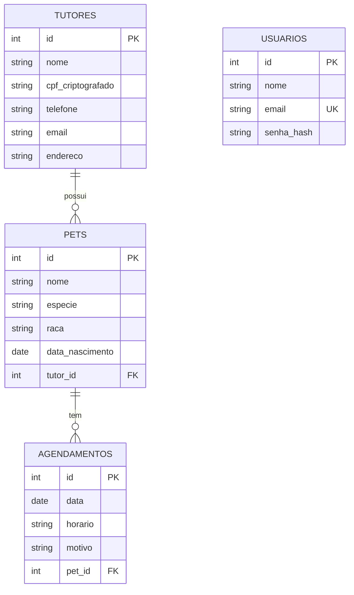

# Documentação de Software 🐾 Sistema da Clínica Veterinária

Sistema web para uma clínica veterinária: **cadastro e gerenciamento de tutores, pets e agendamentos**, com **login com expiração** e **CPF criptografado** no banco (proteção de dados, LGPD).

Este documento foi escrito para **quem vai avaliar o projeto**: explica o que foi entregue, como executar e onde conferir cada item da lista de verificação.

---

## 1. Contexto e objetivo

A clínica fazia o controle de agendamentos e de tutores/pets de forma manual, o que causava perda de consultas, informações duplicadas e falhas no armazenamento, além de falta de proteção aos dados pessoais (como o CPF).
A solução organiza o atendimento e protege os dados: o usuário se autentica, cadastra e consulta tutores, cadastra pets sempre ligados a um tutor e gerencia os agendamentos.

## 2. Requisitos do sistema

### 2.1 Requisitos funcionais

| Código | Requisito |
|---|---|
| RF01 | O sistema deve autenticar o usuário por e-mail e senha, exibindo mensagem de validação quando a autenticação falhar. |
| RF02 | A sessão do usuário deve expirar após um tempo definido (30 minutos), exigindo novo login. |
| RF03 | A tela principal deve exibir o nome do usuário logado, o acesso aos demais recursos e uma forma de sair do sistema. |
| RF04 | O sistema deve permitir cadastrar, listar, buscar por um termo, editar e excluir tutores. |
| RF05 | O sistema deve permitir cadastrar, listar, editar e excluir pets, sempre associados a um tutor. |
| RF06 | O sistema deve listar os agendamentos ordenados por dia, com os dados do tutor e do pet, e permitir atualizar a data de um agendamento já cadastrado. |

### 2.2 Requisitos não funcionais

| Código | Requisito |
|---|---|
| RNF01 | O CPF dos tutores deve ser armazenado **criptografado** no banco e exibido sempre mascarado. |
| RNF02 | As senhas devem ser armazenadas apenas como **hash** (nunca em texto puro). |
| RNF03 | A API deve ser protegida por **token com expiração**; rotas (exceto login) exigem autenticação. |
| RNF04 | Os dados devem ser **validados** no back-end (CPF, e-mail, telefone, datas). |
| RNF05 | O sistema deve ter documentação técnica e diagrama entidade-relacionamento. |

### 2.3 Requisitos de infraestrutura

| Item | Especificação |
|---|---|
| **SGBD** | SQLite 3 (banco de dados relacional, linguagem SQL) |
| **Linguagem do back-end** | Python 3.10 ou superior, com o framework FastAPI |
| **Linguagem do front-end** | JavaScript, com a biblioteca React (Vite) e Node.js 18 ou superior |
| **Bibliotecas principais** | FastAPI, SQLAlchemy, PyJWT, cryptography (back); React, React Router (front) |
| **Sistema operacional** | Windows, Linux ou macOS |
| **Navegador** | Chrome, Edge ou Firefox atualizados |

---

## 3. Estrutura do projeto

```
clinica-veterinaria/
├── README.md
├── back/                  API em Python + FastAPI
│   ├── app/
│   │   ├── main.py        inicia a API
│   │   ├── config.py      configurações (chaves, expiração do token)
│   │   ├── database.py    conexão e execução do script SQL
│   │   ├── models.py      tabelas (SQLAlchemy)
│   │   ├── schemas.py     validação dos dados
│   │   ├── security.py    hash de senha, JWT e criptografia do CPF
│   │   └── routers/       rotas: auth, tutores, pets, agendamentos
│   ├── seed.py            recria o banco do zero com os dados de exemplo
│   ├── utils_seed.py      gera CPF criptografado / hash de senha
│   └── requirements.txt
├── front/                 interface em React
│   └── src/ (pages, components, api.js, auth.jsx)
└── banco/
    ├── script.sql         criação das tabelas + população (seed)
    └── diagrama_er.png    diagrama entidade-relacionamento
```

---

## 4. Como executar

Pré-requisitos: **Python 3.10+** e **Node.js 18+** (confira com `python --version` e `node --version`).

### 4.1 Back-end — terminal 1, pasta `back`

**Windows (PowerShell):**
```powershell
cd back
python -m venv .venv
.venv\Scripts\activate
pip install -r requirements.txt
python -m uvicorn app.main:app --reload
```

**Linux / macOS:**
```bash
cd back
python3 -m venv .venv
source .venv/bin/activate
pip install -r requirements.txt
python -m uvicorn app.main:app --reload
```

A API sobe em http://127.0.0.1:8000 (documentação interativa em http://127.0.0.1:8000/docs).
Na primeira execução o banco `banco/clinica.db` é **criado e populado automaticamente** a partir do `banco/script.sql`.

### 4.2 Front-end — terminal 2, pasta `front`

```bash
cd front
npm install
npm run dev
```

Abra http://localhost:5173 no navegador.

### 4.3 Usuários de teste (populados pelo script)

| E-mail | Senha |
|---|---|
| admin@clinica.com | Admin@123 |
| gabriella@clinica.com | gabi123 |
| recepcao@clinica.com | Recep@123 |

Para voltar aos dados originais a qualquer momento: na pasta `back`, com o ambiente ativo, rode `python seed.py`.

---

## 5. Diagrama Entidade-Relacionamento




Relacionamentos: um **tutor** possui vários **pets** (`pets.tutor_id → tutores.id`) e um **pet** possui vários **agendamentos** (`agendamentos.pet_id → pets.id`). A tabela **usuarios** é independente e serve à autenticação.

---

## 6. Roteiro de verificação (onde conferir cada item)

### Atividade 1 — Documentação de software
| Item | Onde conferir |
|---|---|
| 1.1 Requisitos do sistema (mínimo 4) | Seção **2.1** e **2.2** deste documento (6 requisitos funcionais e 5 não funcionais) |
| 1.2 Requisitos de infraestrutura (SGBD e linguagem) | Seção **2.3** (SQLite; Python/FastAPI; JavaScript/React) |
| 1.3 Diagrama entidade-relacionamento | Seção **5** e arquivo `banco/diagrama_er.png` |

### Atividade 2 — Script de criação e população do banco
| Item | Onde conferir |
|---|---|
| 2.1 Tabelas com chaves estrangeiras | `banco/script.sql`: `CREATE TABLE pets` (`FOREIGN KEY (tutor_id) REFERENCES tutores`) e `CREATE TABLE agendamentos` (`FOREIGN KEY (pet_id) REFERENCES pets`) |
| 2.2 Pelo menos 3 registros por tabela | `banco/script.sql`, blocos `INSERT INTO`: usuarios (3), tutores (5), pets (6), agendamentos (6) |

### Atividade 3 — Funcionalidade de login
| O que verificar | Como testar |
|---|---|
| Validação em caso de falha | Na tela de login, informe uma senha errada → aparece "E-mail ou senha inválidos."; deixe campos vazios → aparece "Informe e-mail e senha." |
| Login com sucesso | Entre com `admin@clinica.com` / `Admin@123` → abre a tela principal com o nome do usuário |
| Autenticação com expiração | Token JWT de 30 minutos (`back/app/security.py`, `TOKEN_EXPIRE_MINUTES` em `config.py`); ao expirar, o sistema volta ao login com aviso |
| Senha protegida | Coluna `senha_hash` no `script.sql` contém hash PBKDF2, não a senha |
| Tela principal | Mostra o nome do usuário logado, o menu para Tutores/Pets/Agendamentos e o botão **Sair** |

### Demais funcionalidades (regras de negócio do enunciado)
| Regra | Como testar |
|---|---|
| CPF criptografado no banco | Coluna `cpf_criptografado` do `script.sql` (valores cifrados); na tela, o CPF aparece mascarado (`***.456.789-**`) |
| Tutor: busca por termo | Menu **Tutores** → digite `fern` → **Buscar** → a tabela mostra só os registros correspondentes |
| Tutor: editar e salvar | **Editar** → alterar o telefone → **Salvar** → a tabela mostra o novo valor (persistido no banco) |
| Agendamentos ordenados por dia | Menu **Agendamentos** → lista em ordem de data/hora, com dados do pet e do tutor |
| Agendamento: atualizar a data | **Alterar data** → escolher nova data → **Salvar** |
| Pet associado a um tutor | **Pets** → **Novo pet** → tente salvar sem escolher o tutor → o sistema impede |

---

## 7. Rotas da API

Todas, exceto o login, exigem o cabeçalho `Authorization: Bearer <token>`.

| Método | Rota | Função |
|---|---|---|
| POST | `/auth/login` | Autentica e devolve o token |
| GET | `/auth/me` | Dados do usuário logado |
| GET | `/tutores?busca=termo` | Lista / busca tutores |
| POST, PUT, DELETE | `/tutores`, `/tutores/{id}` | Cadastra / edita / exclui |
| GET, POST | `/pets` | Lista / cadastra pet |
| PUT, DELETE | `/pets/{id}` | Edita / exclui |
| GET, POST | `/agendamentos` | Lista ordenada por dia / cadastra |
| PUT | `/agendamentos/{id}` | Atualiza a data (e opcionalmente hora/motivo) |
| DELETE | `/agendamentos/{id}` | Exclui |

## 8. Segurança e proteção de dados

- Senhas com hash PBKDF2-SHA256 (200 mil iterações) e salt aleatório.
- CPF criptografado com Fernet (chave em `ENCRYPTION_KEY`) e nunca devolvido por completo pela API.
- Token JWT com expiração; mensagem de erro de login genérica (não revela se o e-mail existe).
- Validação de CPF (dígitos verificadores), e-mail, telefone e datas no back-end.
- Em produção, trocar `SECRET_KEY` e `ENCRYPTION_KEY` (modelo em `back/.env.example`).

## 9. Problemas comuns

- **`uvicorn` não é reconhecido:** use `python -m uvicorn app.main:app --reload` com o ambiente virtual ativo.
- **Front mostra "Não foi possível conectar ao servidor":** o back não está rodando (porta 8000).
- **`npm install` / `pip install` falham:** pode ser proxy de rede; configure o proxy do npm/pip.
